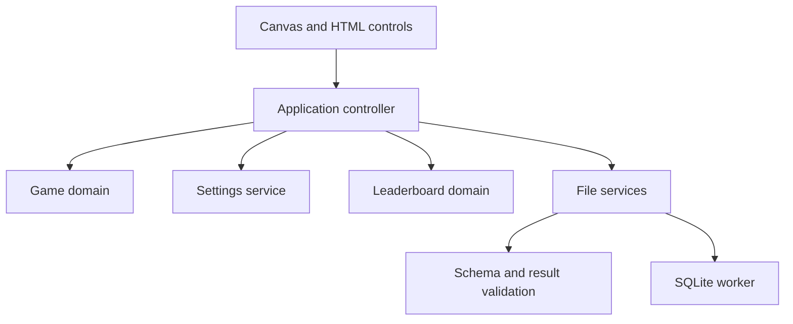

# Architecture

## System context

The [project brief](PROJECT.md) defines a static, single-player browser game. TypeScript supplies explicit state and file-boundary types; Canvas renders the board and HTML provides controls, status, previews and the leaderboard. There is no application server, account service or remote score store. All production dependencies and WebAssembly assets are bundled with the application; gameplay does not depend on a third-party CDN.

## Blocks and dependency direction

| Block | Responsibility and owned state | Dependencies |
| --- | --- | --- |
| Game domain | Board, active piece, queue/randomizer state, hold, score/level, bonuses, grounding and locking. Produces snapshots and events from commands and elapsed game time. | Pure TypeScript rules and injected random source; no DOM, wall clock, storage or file access. |
| Application controller | Owns the live domain instance, logical clock, command ordering, pause reasons and active settings. Routes completed games once to the leaderboard. | Domain plus ports for browser input, presentation, configuration, time, IDs and leaderboard operations. |
| Browser presentation | Canvas drawing, HTML panels, keyboard/control translation, focus handling and visible errors. Holds no independent game-rule state. | Read-only snapshots and controller commands. |
| Configuration | Validates six independent settings and reconciles query/cookie/default sources. Owns serialized settings and runtime persistence warnings. | Browser URL/history and cookie adapters; typed setting definitions shared with controller. |
| Leaderboard domain | Owns the page-lifetime top ten, ranking, stable result identity and atomic replacement of validated results. | Pure result validation and injected ID/UTC timestamp providers. |
| File services | JSON Schema validation and JSON/SQLite encoding/decoding, resource limits and download/file selection adapters. Owns temporary bytes, workers, database handles and download URLs. | Result contracts, bundled schema validator and SQLite runtime; returns candidates without mutating the leaderboard. |

Dependency flow is browser input → controller → game domain and services; snapshots/events flow back to presentation. File codecs and persistence adapters cannot dispatch game commands or write leaderboard state. Shared definitions contain data contracts, not service locators or mutable global state.

## Game-state and timing model

Use one serial transition function for input and elapsed-time changes. The controller advances logical game time before processing a command and renders the resulting snapshot. Pause reasons compose: user pause, hidden/unfocused gameplay and file operations cannot accidentally resume one another. Paused wall time never reaches the domain.

The domain owns a grounding deadline and the gravity interval captured for its grounding episode. Lateral movement/rotation while grounded preserves that deadline; becoming airborne clears it. Per-piece locking policies are captured at spawn. Availability/visibility setting changes use current settings without rewriting those captured policies. Deadline ties are resolved consistently by the transition contract in SPEC.

Collision, projection and locking are different responsibilities. A single landing service supplies ghost and hard-drop targets. Ordinary pieces stop at the first obstructed downward position. Penetrators may cross occupied cells but must retain a legal landing at or below the candidate position; their target is the deepest valid non-overlapping position. Locking independently verifies full containment and non-overlap before mutating the board. No occupied cell is overwritten by penetration.

Seven-bag state and the active queue live in the domain. Rotation data is immutable, including separate SRS kick tables for I and JLSTZ pieces. O rotation preserves its occupied cells. Hold and bonus use are domain transitions rather than UI-only restrictions.

## Configuration boundary

Setting definitions own allowed tokens and defaults. Resolution is per setting, with duplicate/invalid query values treated as absent and invalid cookies falling back to defaults. Explicit valid query values are written to cookies even when equal to defaults. An omitted query parameter never schedules a default cookie write.

The configuration service attempts cookie and URL updates independently. An unavailable cookie or history API cannot prevent the selected in-memory setting from taking effect. The presentation reports persistence failure without claiming it was saved. Browser reload behavior follows the sources that actually survived.

## Leaderboard and file boundary

The leaderboard is an in-memory collection for the current page lifetime. A game-over event creates one result using injected ID/time providers; restarts do not erase the collection or create abandoned-game results. Ranking and truncation are shared by new results and restored candidates.

Save captures a stable snapshot. Restore reads a bounded file, identifies its format from content, decodes and validates every record into a fresh candidate collection, then performs one controller-owned replacement. During the operation gameplay is paused and file controls are disabled, so a completed game cannot race replacement. Cancel, validation failure, worker timeout and download failure leave the existing collection intact.

JSON uses a bundled JSON Schema with an explicitly registered strict UTC timestamp format. Schema validation runs without coercion, defaults or property removal; shared result validation adds ID uniqueness and safe numeric guarantees. SQLite uses a bundled sql.js WebAssembly build inside a dedicated worker, with `PRAGMA user_version` for versioning. It exposes one application table and passes decoded rows through the same result validator. Reading an import never executes SQL obtained from that file. Fresh database creation and parameterized inserts are separate from read-only import processing.

SQLite is loaded only for a SQLite operation. The controller bounds worker lifetime and rejects stale replies by operation identity. Termination/disposal frees database, worker and file resources on success, error, cancellation and timeout. JSON availability and ordinary gameplay do not depend on successful SQLite initialization.

## Design choices and tradeoffs

- Pure domain transitions make timing, landing and score behavior reproducible without browser scheduling or pixel tests. The controller serializes real events rather than allowing renderer callbacks to mutate rules.
- Canvas is appropriate for a small grid; HTML retains native control focus, labels, buttons and readable status. A framework or game engine would add infrastructure without a demonstrated need.
- Small function/module boundaries are preferred over class hierarchies, dependency-injection frameworks or generic plugin registries. Ports exist for real time, entropy, browser storage and file dependencies only.
- SQLite WebAssembly adds download/initialization cost. Lazy local loading and worker isolation keep that cost outside normal play and allow a finite import deadline.
- One shared result validator prevents JSON and SQLite from disagreeing on accepted scores or timestamps. The published JSON Schema remains the structural authority for JSON imports; semantic checks supplement it.

## Verification seams and invariants

The game domain is tested using controlled entropy, commands and exact elapsed times. Configuration uses synthetic URLs/cookie adapters; leaderboard tests inject IDs/timestamps; codecs exercise real JSON and SQLite byte round trips. Browser checks cover actual input focus, Canvas output, cookie/query persistence, downloads/uploads and error preservation in isolated Chromium and Firefox as governed by [BROWSER_DEV_POLICY](../../BROWSER_DEV_POLICY.md).

System-wide invariants are one live game-state owner, one authoritative landing calculation, legal non-overlapping locks, no hold while penetrator-active, no duplicate game-over result, no partial leaderboard replacement, no automatic permanent score writes and no production network service dependency. Precise behavioral contracts belong to SPEC; logical components belong to DECOMPOSITION and physical allocation to layout.

## Dependency documentation

The [sql.js API](https://sql.js.org/documentation/) documents asynchronous WebAssembly initialization and browser/worker builds. [SQLite PRAGMA documentation](https://www.sqlite.org/pragma.html#pragma_user_version) defines the application-controlled user version metadata. [Ajv format documentation](https://ajv.js.org/guide/formats.html) requires explicit format support rather than assuming date-time validation is built in. Pin and verify compatible package versions during implementation; no runtime installation or browser capability has been demonstrated by this design.
